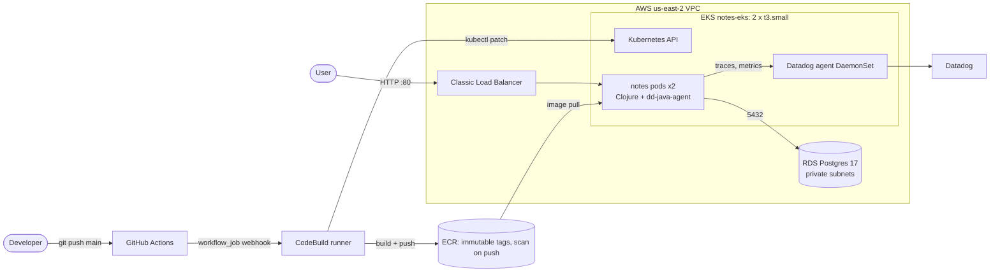

# clj-notes-platform

A small Clojure notes API running on AWS like a production service: infrastructure in Terraform, EKS,
RDS Postgres, keyless CI/CD that deploys every push to `main`, and Datadog APM.
Built to practice the platform work behind a Clojure/Kubernetes/AWS stack.

## Architecture



## What's in the repo

| Path | What it is |
|------|-----------|
| `app/` | Clojure service (Ring/Jetty, reitit, next.jdbc), uberjar build, multi-stage Dockerfile |
| `compose.yaml` | Local dev: app + Postgres |
| `infra/` | Terraform: VPC, EKS, RDS, ECR, CodeBuild runner, IAM, EKS access entries |
| `k8s/` | Deployment + Service manifests, Datadog Helm values |
| `.github/workflows/deploy.yml` | Build → push → scan gate → rolling deploy |

**Endpoints:** `GET /health` (liveness), `GET /ready` (readiness, checks the DB), `GET/POST /notes`.

## Run it locally

```bash
docker compose up --build
curl localhost:8080/notes
curl -X POST localhost:8080/notes -H 'Content-Type: application/json' -d '{"body":"hello"}'
```

## Deploy

```bash
terraform -chdir=infra init
terraform -chdir=infra apply
aws eks update-kubeconfig --name notes-eks --region us-east-2
# create the notes-db secret from the RDS-managed Secrets Manager secret, then:
kubectl apply -f k8s/notes.yaml
helm install datadog datadog/datadog -f k8s/datadog-values.yaml
```

After that, every push to `main` that touches `app/` builds the image, pushes it to ECR, fails the
build on CRITICAL scan findings, and runs a rolling deploy tagged with the git SHA.

## Design decisions

| Decision | Why | Trade-off |
|----------|-----|-----------|
| **No NAT gateway**: nodes in public subnets, RDS in private subnets | NAT costs about $32/month per AZ, more than the whole rest of the stack | Nodes have public IPs (security groups still restrict inbound). Production would use private nodes + NAT or VPC endpoints |
| **CodeBuild-hosted GitHub Actions runner** instead of GitHub OIDC | The account's SCP blocks creating IAM OIDC providers, and long-lived access keys were ruled out | The runner assumes an IAM role, so there are still no static keys. A bit more infrastructure than OIDC |
| **EKS access entries** with `AmazonEKSEditPolicy` scoped to namespace `default` | Least privilege: CI can deploy the app but not change cluster-wide resources | — |
| **Immutable ECR tags** using the git SHA | Every running pod traces back to a commit, and tags can't be overwritten | Re-running a failed job needs a new commit |
| **Scan gate in CI** | Blocks known CRITICAL CVEs before they reach the cluster | Basic scanning only covers OS packages; Inspector would also cover dependencies |
| **RDS-managed master password** (Secrets Manager) | No password in Terraform state or in git | The Kubernetes Secret is synced by hand for now (see next steps) |
| **Separate `/health` and `/ready`** | A database outage takes pods out of the load balancer instead of restarting them all | — |
| **Datadog auto-instrumentation** (dd-java-agent) | Jetty and JDBC spans without code changes; unified service tags link traces to deploys | Business-level spans would need custom instrumentation |
| **S3 backend with native lockfile locking** | shared, versioned, encrypted state with no DynamoDB table; a separate bootstrap config solves the chicken-and-egg problem | &mdash; |

## Problems I hit and how I fixed them

1. **The SCP blocked IAM OIDC providers.** EKS IRSA and GitHub OIDC both failed at the
   `CreateOpenIDConnectProvider` step. I turned off IRSA and moved CI to a CodeBuild-hosted runner that assumes an IAM role.
2. **Credentials expired in the middle of `terraform apply`.** Exported credentials only last 15 minutes. I switched to a profile
   using `credential_process`, so the SDK refreshes them itself.
3. **Docker on Windows couldn't save the ECR login** ("The stub received bad data"). The ECR token is too big for Windows
   Credential Manager. I used a separate `DOCKER_CONFIG` folder with file-based auth.
4. **EKS `AssociateAccessPolicy` returned a 404.** Terraform created the policy association before the access entry
   existed. I referenced the entry's attribute so Terraform knows the dependency.
5. **The scan gate failed with `ScanNotFoundException`.** A registry-level scanning configuration with no rules overrode
   the repository's scan-on-push. I managed the registry scanning configuration in Terraform.
6. **The same error came back as a race.** The scan record appears a few seconds after the push, so the gate now polls until it exists, then waits for the scan to finish.

## Cost

About $0.21/hour (~$5/day) with everything running: the EKS control plane, 2 × t3.small, db.t4g.micro and a Classic LB.
Tear it down when you're not using it:

```bash
kubectl delete -f k8s/notes.yaml   # removes the load balancer first
helm uninstall datadog
terraform -chdir=infra destroy
```

## What I'd add next

- **EKS Pod Identity + External Secrets Operator:** sync the DB secret from Secrets Manager instead of by hand.
- **SQS worker:** an event-driven second service (notes created → queue → worker), with a DLQ and alarms.
- **Helm chart + Argo CD:** GitOps deploys instead of `kubectl patch` from CI, plus environment promotion.
- **Python `devctl` CLI:** one command for local setup, port-forwarding and log tailing.
- **Structured JSON logs with trace IDs:** logs that link to traces in Datadog.
- **Private nodes + VPC endpoints, plus a pinned tracer version:** to harden the setup for production.
- `terraform plan` on pull requests.